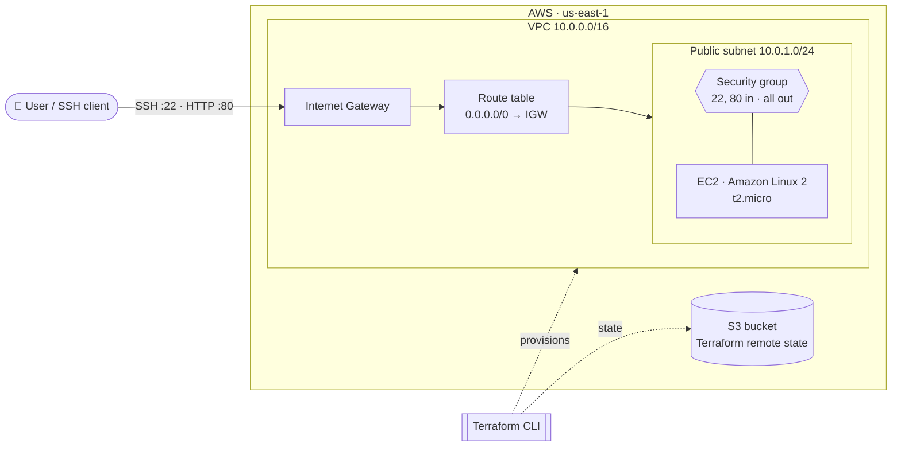

<div align="center">

# ☁️ AWS Infrastructure Provisioning with Terraform

**A VPC, public subnet, routing, security group and EC2 instance on AWS, built with one `terraform apply` and stored in an S3 remote state backend.**


[](LICENSE)

</div>

## 📌 Overview
This project provisions an AWS network and compute stack entirely with Terraform. No resources are created by clicking through the AWS Console. State is stored in an S3 backend, so it survives local machine loss and stays consistent between runs.

## 🏗️ Architecture



| Resource | Details |
|---|---|
| **VPC** | Isolated network, CIDR `10.0.0.0/16` |
| **Public subnet** | `10.0.1.0/24`, auto-assigns public IPs |
| **Internet gateway** | Gives the VPC internet access |
| **Route table** | Sends `0.0.0.0/0` through the IGW, associated with the public subnet |
| **Security group** | Inbound SSH (22) and HTTP (80), all outbound |
| **EC2 instance** | Amazon Linux 2, `t2.micro` |
| **S3 backend** | Remote Terraform state |

## 📁 Project structure
```
terraform-aws-infra/
├── provider.tf      # AWS provider and Terraform version constraints
├── variables.tf     # Input variables (region, CIDRs, AMI, instance type, ...)
├── main.tf          # VPC, subnet, IGW, route table, security group, EC2
├── outputs.tf       # VPC ID, subnet ID, EC2 ID / public IP, SG ID
├── backend.tf       # S3 remote state backend
└── Screenshots/     # AWS Console verification
```

## 🚀 Usage

**Prerequisites:** Terraform, the AWS CLI configured with `aws configure`, and an IAM user allowed to manage VPC/EC2/S3.

> The S3 bucket in `backend.tf` must already exist. If you're using your own AWS account, change `bucket` to a bucket you own.

```bash
terraform init      # download the provider, connect to the S3 backend
terraform plan      # preview the changes
terraform apply     # create the infrastructure
terraform destroy   # tear everything down
```

After `apply`, Terraform prints these outputs:

| Output | Description |
|---|---|
| `vpc_id` | ID of the VPC |
| `subnet_id` | ID of the public subnet |
| `ec2_instance_id` | ID of the EC2 instance |
| `ec2_public_ip` | Public IP of the EC2 instance |
| `security_group_id` | ID of the security group |

## 📸 Screenshots

| EC2 instance running | VPC created |
|---|---|
|  |  |
| **Subnet** | **Route table** |
|  |  |
| **Internet gateway** | **Security group** |
|  |  |

<details>
<summary><b>S3 remote backend</b></summary>


</details>

## 🛠️ Troubleshooting: orphaned route tables
**Issue:** After an incomplete `terraform destroy`, several route tables showed `Main = Yes`.

**Cause:** Terraform state was out of sync. The partial destroy left orphaned VPCs whose route tables were still the main tables.

**Fix:** Found the orphaned VPCs in the AWS Console, deleted their dependent resources manually, then ran `terraform destroy` to clean up the remaining state. The S3 remote backend now keeps state consistent between runs.

## 🔭 Possible next steps
- Restrict SSH (port 22) to a known CIDR instead of `0.0.0.0/0`, or use SSM Session Manager instead of SSH.
- Add DynamoDB state locking to the S3 backend.
- Split the code into reusable `network` and `compute` modules.
- Run `terraform fmt -check` and `terraform validate` in GitHub Actions.

## 🧰 Tech stack
Terraform · AWS VPC · EC2 · S3 · IAM · Linux

## 📄 License
[MIT](LICENSE) © Anubhav Arora
