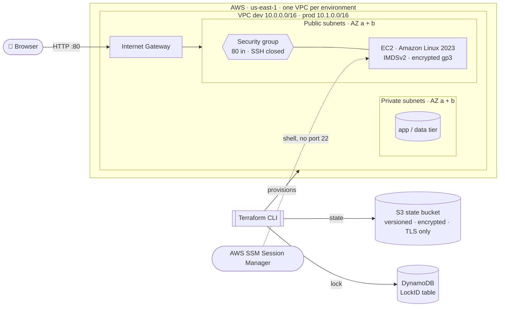
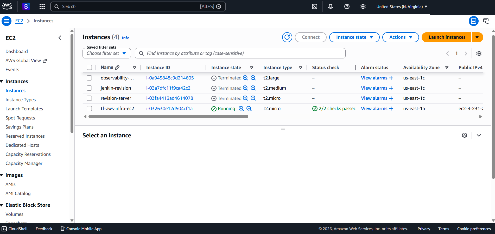
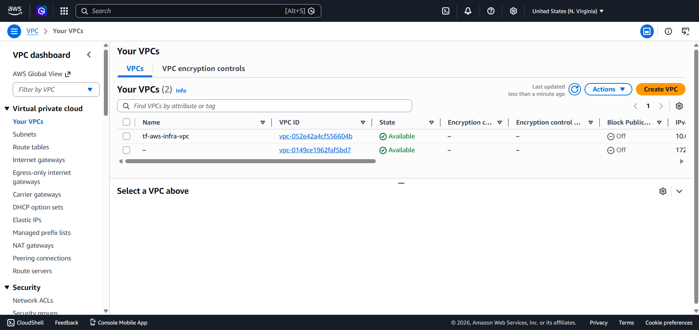
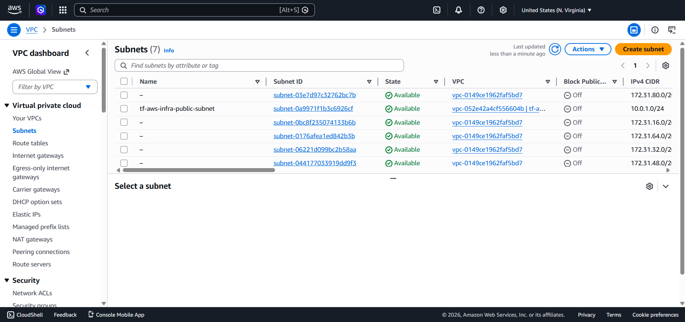
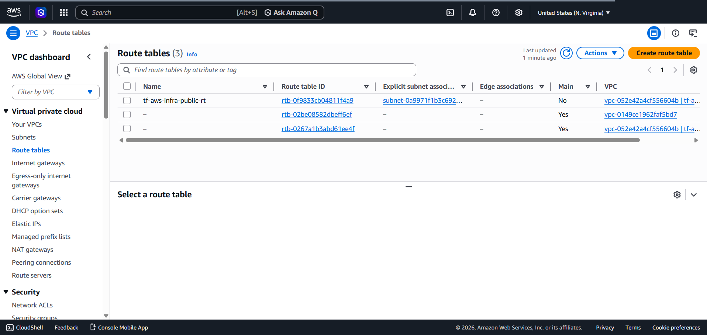
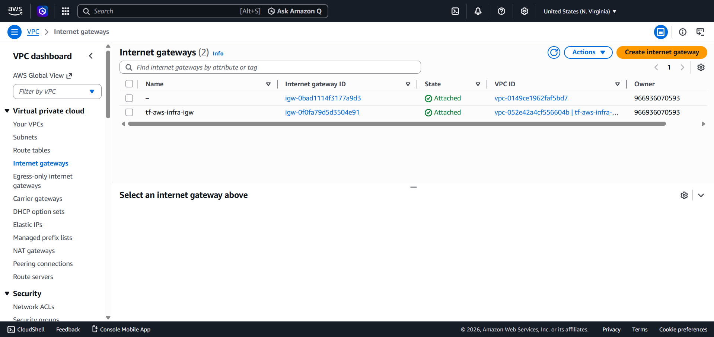
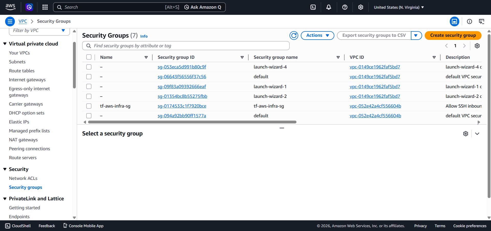
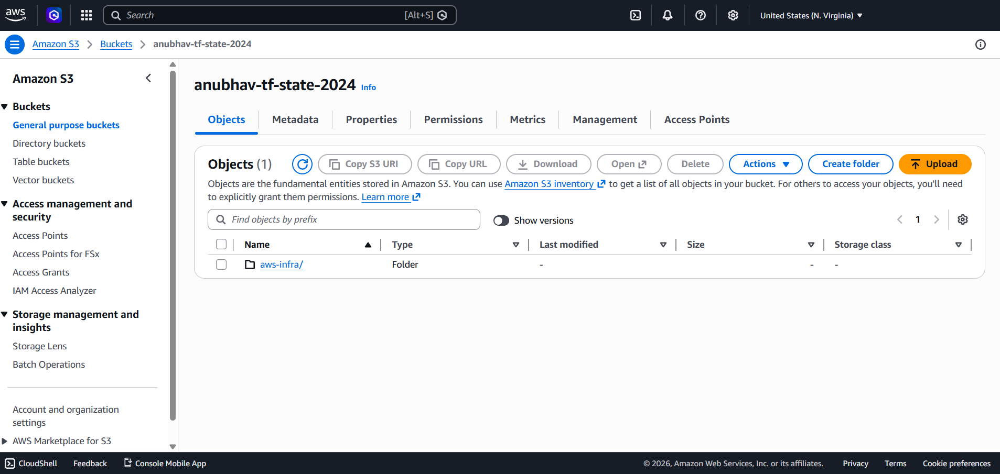

<div align="center">

# ☁️ AWS Infrastructure with Terraform

**Reusable `network` and `compute` modules, separate `dev` and `prod` environments, and remote state in S3 with DynamoDB locking. Formatted, validated, linted and unit-tested in GitHub Actions on every push.**


[](https://github.com/anubhav1941/terraform-aws-infra/actions/workflows/terraform.yml)
[](LICENSE)

</div>

## 📌 Overview
One codebase, two environments. `dev` and `prod` call the same modules with different CIDRs and instance sizes, and each keeps its own state file in a shared S3 bucket. A DynamoDB table locks the state, so two `terraform apply` runs can never change the same environment at once. The bucket and the table are themselves created by Terraform, in a small `bootstrap` stack.

## 🏗️ Architecture



| Piece | What it does |
|---|---|
| **`modules/network`** | VPC, public and private subnets across two AZs, internet gateway, route tables. Optional single NAT gateway (`enable_nat_gateway`, off by default because it's billed hourly). |
| **`modules/compute`** | Security group (HTTP in, SSH closed unless you pass a `/32`), EC2 on the latest Amazon Linux 2023 AMI, IMDSv2 required, encrypted gp3 root volume, IAM role for SSM Session Manager, nginx test page via user data. |
| **`envs/dev`, `envs/prod`** | Thin root modules: same modules, different values (`10.0.0.0/16` + `t3.micro` vs `10.1.0.0/16` + `t3.small`), separate state keys. |
| **`bootstrap`** | The S3 state bucket (versioning, encryption, public access blocked, TLS-only policy, old versions expire after 90 days) and the DynamoDB lock table (on-demand, point-in-time recovery). |

## 📁 Project structure
```
terraform-aws-infra/
├── bootstrap/                 # one-time: state bucket + lock table (local state)
├── modules/
│   ├── network/               # VPC, subnets, IGW, routes, optional NAT
│   │   └── tests/             # terraform test, AWS provider mocked
│   └── compute/               # SG, IAM role, EC2
│       └── tests/
├── envs/
│   ├── dev/                   # backend.hcl, main.tf, outputs.tf, ...
│   └── prod/
├── .github/workflows/terraform.yml   # fmt · validate · test · tflint
├── .tflint.hcl
└── Screenshots/               # AWS Console verification (v1, single environment)
```

## 🚀 Usage

**Prerequisites:** Terraform ≥ 1.5 (≥ 1.7 to run the tests), the AWS CLI configured with `aws configure`, and an IAM user allowed to manage VPC, EC2, IAM, S3 and DynamoDB.

**1. Create the state backend (once).** The bucket name must be globally unique: change `state_bucket_name` in `bootstrap/variables.tf` and `bucket` in `envs/*/backend.hcl` if you use your own account.
```bash
cd bootstrap
terraform init
terraform apply
```
If the bucket already exists (it did for v1 of this repo), adopt it instead of creating it:
`terraform import aws_s3_bucket.state <bucket-name>`, then `terraform apply`.

**2. Deploy an environment.**
```bash
cd envs/dev
terraform init -backend-config=backend.hcl
terraform plan
terraform apply
curl "$(terraform output -raw web_url)"     # nginx page: "tf-aws-infra: dev"
```
Same steps in `envs/prod`. Shell access without SSH: `aws ssm start-session --target "$(terraform output -raw ec2_instance_id)"`.

**3. Tear down** with `terraform destroy` in each environment. The bootstrap bucket has `prevent_destroy` set on purpose.

## ✅ Checks (CI and local)
| Check | Command |
|---|---|
| Formatting | `terraform fmt -check -recursive` |
| Validation (bootstrap, dev, prod) | `terraform init -backend=false && terraform validate` |
| Unit tests (offline, provider mocked) | `cd modules/network && terraform init -backend=false && terraform test` |
| Lint | `tflint --init && tflint --recursive` |

The tests assert the important behaviour without touching AWS: one public and one private subnet per AZ, no NAT unless asked, IMDSv2 required, an encrypted root volume, SSH closed by default, and SSH from `0.0.0.0/0` rejected.

## 🔐 A note on state locking
DynamoDB is the long-standing way to lock S3 state, and what most existing setups use. Terraform 1.10 added native S3 locking (`use_lockfile = true`) and from 1.11 marks `dynamodb_table` as deprecated, so `terraform init` prints a deprecation warning on recent versions. Migrating is one change per environment: add `use_lockfile = true` to `backend.hcl`, run `terraform init -reconfigure` while both locks are active, then remove `dynamodb_table` and the table.

## 🛠️ Troubleshooting: orphaned route tables
**Issue:** After an incomplete `terraform destroy`, several route tables showed `Main = Yes`.

**Cause:** Terraform state was out of sync. The partial destroy left orphaned VPCs whose route tables were still the main tables.

**Fix:** Found the orphaned VPCs in the AWS Console, deleted their dependent resources manually, then ran `terraform destroy` to clean up the remaining state. Remote state in S3 (and now locking) keeps state consistent between runs.

## 📸 Screenshots (v1, single environment)

| EC2 instance running | VPC created |
|---|---|
|  |  |
| **Subnet** | **Route table** |
|  |  |
| **Internet gateway** | **Security group** |
|  |  |

<details>
<summary><b>S3 remote backend</b></summary>



</details>

## 💰 Cost
Idle cost is close to zero: the lock table is on-demand and the state bucket holds a few KB. Each environment runs one small EC2 instance while it's up. A NAT gateway is the expensive part of a VPC, so it's off unless you enable it. Destroy environments when you're done.

## 🧰 Tech stack
Terraform · AWS VPC · EC2 · IAM · SSM · S3 · DynamoDB · GitHub Actions · TFLint

## 📄 License
[MIT](LICENSE) © Anubhav Arora
